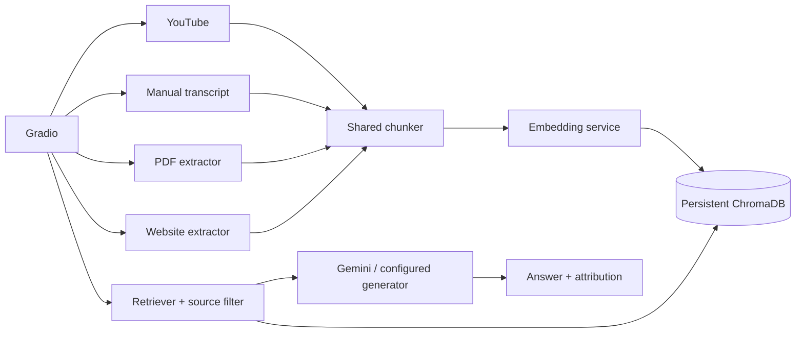

# YouTube RAG Assistant — Multi-Source AI Learning Assistant

This Python/Gradio project is a Retrieval-Augmented Generation (RAG) assistant for questions about indexed learning resources. It supports YouTube channels and videos, authorized manual transcripts, text PDFs, and individual public webpages. Content is extracted, chunked, embedded, stored in persistent ChromaDB, retrieved semantically, and supplied to a configurable LLM, including Gemini.

This document describes the implementation currently present in the repository. It does not claim live-service success, benchmark results, or complete end-to-end validation where the current environment cannot provide them.

## Abstract

Learning material is often distributed across long videos, transcripts, PDF notes, and webpages. Manually locating one explanation is slow, while a general language model may not have access to the relevant course content. This project implements a Retrieval-Augmented Generation assistant that builds a searchable knowledge base from supported resources. YouTube transcripts, authorized pasted transcripts, extractable PDF text, and individual webpages are divided into overlapping chunks. Each chunk is converted into a semantic vector using a local SentenceTransformers model and persisted with metadata in ChromaDB. For a question, the application embeds the query, retrieves related chunks, optionally filters retrieval by source metadata, and supplies the selected context to the configured language model, including Gemini. The Gradio UI provides indexing and chat workflows. Stable source IDs and deterministic chunk IDs are used by newer source paths to reduce duplicates and support source deletion. Source-scoped retrieval is intended to prevent unrelated indexed material from entering an answer. Current limitations include transcript availability and rate limits, webpage/PDF extraction quality, absent OCR, legacy records without source metadata, dependency setup, and incomplete end-to-end validation in restricted environments.

## Problem statement

Students and researchers need to search lengthy instructional videos, transcripts, documents, and webpages for precise concepts. Keyword search misses paraphrases, while an LLM without the learning material may produce unsupported answers. A multi-source assistant must also prevent unrelated content from being mixed into an answer and should identify supporting sources.

The original project focused on YouTube channel transcripts. Later work added direct video indexing, manual transcript fallback, PDF and webpage extraction, source metadata, and metadata-filtered retrieval.

## Objectives and scope

- Extract supported learning resources and divide them into chunks.
- Generate semantic embeddings and persist chunks in ChromaDB.
- Retrieve relevant context and generate grounded answers.
- Support source-scoped retrieval using metadata filters.
- Provide YouTube, PDF, website, manual-import, and Chat workflows in Gradio.
- Provide deterministic identifiers, source listing, and source deletion where implemented.

OCR, recursive website crawling, formal answer-quality evaluation, and complete migration of legacy records are not implemented.

## Features and status

| Feature | Implementation |
|---|---|
| Channel indexing | `IndexingService.index_channel()` uses YouTube Data API metadata, transcript retrieval, chunking, embeddings, and ChromaDB. Videos without captions are skipped. |
| Direct video indexing | Parses a YouTube URL/ID, fetches metadata/transcript, and indexes the transcript. |
| Manual import | Authorized pasted transcript text uses the common chunk/embed/store pipeline. |
| PDF indexing | `src.sources.extract_pdf()` uses PyMuPDF and stores page numbers. |
| Website indexing | `fetch_website()` validates public HTTP(S), limits redirects/size, removes common HTML boilerplate, and extracts title/text. |
| Source dropdown | Labels are built from stored metadata; the internal value is stable `source_id`. |
| Scoped retrieval | A selected source becomes a ChromaDB `where={"source_id": ...}` filter before generation. |
| All Sources | An empty filter searches the collection globally. |
| Source management | Source listing and individual deletion are implemented through Chroma metadata. |
| Gemini | `GeminiGenerator` uses the official `google-genai` client when configured. |
| Attribution | Chat preserves source metadata; UI attribution is currently strongest for YouTube. |

UI presence is not treated as proof of successful external retrieval; network and dependency verification are required.

## Technology stack

| Technology | Role | Location |
|---|---|---|
| Python 3.10+ | Application language | Entire project |
| Gradio | Web UI/callbacks | `src/app.py` |
| `google-genai` | Gemini client | `src/rag/generator.py` |
| SentenceTransformers | Local embeddings | `src/rag/embeddings.py` |
| `sentence-transformers/all-MiniLM-L6-v2` | Default embedding model | `src/core/config.py` |
| ChromaDB | Persistent vector store/filtering | `src/rag/vectorstore.py` |
| YouTube Data API v3 | Channel/video metadata | `src/youtube/` |
| `youtube-transcript-api`, `yt-dlp` | Public captions/fallback | `src/youtube/transcripts.py` |
| PyMuPDF | PDF extraction | `src/sources.py` |
| BeautifulSoup, Requests | Web extraction/fetching | `src/sources.py` |
| LangChain text splitters | Recursive chunking | `src/rag/chunker.py` |
| Pydantic Settings | Environment configuration | `src/core/config.py` |

OpenAI and Anthropic implementations remain in the repository as optional providers; the intended configuration for this version is Gemini with local embeddings.

## Architecture



The indexing service orchestrates source extraction and shared processing. Chat embeds the question, applies a metadata filter before vector search when a source is selected, and supplies retrieved text to the generator.

## Methodology

### Indexing workflow

1. The user submits a source.
2. The source-specific extractor validates and obtains text.
3. `RecursiveCharacterTextSplitter` creates overlapping chunks.
4. Source metadata is attached to every chunk.
5. The embedding service creates vectors.
6. ChromaDB stores text, vectors, metadata, and deterministic IDs using `upsert()`.

### Question-answering workflow

1. The user chooses `All Sources` or one indexed source.
2. The callback validates the selected ID.
3. The question is embedded.
4. ChromaDB receives `where={"source_id": selected_source_id}` for a specific source.
5. Retrieved text is passed to Gemini or the configured generator.
6. The answer and available source metadata are displayed.

No-result retrieval returns a no-relevant-information response; it does not silently fall back to an unfiltered search.

## Source identity and isolation

New source IDs are generated as follows:

- YouTube: `youtube:<video_id>`.
- PDF: `pdf:<short SHA-256 hash of filename>`.
- Website: `website:<short SHA-256 hash of normalized URL>`.
- Manual transcript: `manual_transcript:<video ID or manual-transcript>`.

New chunk IDs are deterministic, for example `youtube:<video_id>:0`, `website:<hash>:0`, and `pdf:<hash>:page1:0`. Re-indexing uses upsert and source-specific replacement where implemented.

Illustrative metadata:

```json
{
  "source_id": "pdf:31c2...",
  "source_type": "pdf",
  "workspace_id": "default",
  "source_name": "Operating Systems Notes.pdf",
  "page_number": 3
}
```

YouTube records also contain video/channel fields; websites contain `source_url`; PDF records contain `page_number`. Records created before `source_id` was introduced are not safely selectable and should be re-indexed after backing up `data/chroma_db`.

The dropdown maps readable labels to IDs for usability. Isolation is enforced by the ChromaDB metadata filter, not by adding instructions to the user question.

## Chunking, embeddings, and vector search

`RecursiveChunker` defaults to `CHUNK_SIZE=1000` and `CHUNK_OVERLAP=200`. It splits by paragraphs, lines, sentences, words, and characters as needed. Local embeddings use `sentence-transformers/all-MiniLM-L6-v2` when `SHOULD_LOCAL_EMBED=true`; otherwise the configured OpenAI embedder is used. ChromaDB performs cosine-distance search. `RETRIEVAL_K` defaults to 5. Filtering restricts the candidate set before semantic ranking.

## Gemini integration

`GeminiGenerator` creates `google.genai.Client(api_key=GEMINI_API_KEY)` and calls `models.generate_content` with retrieved context and the question. Missing configuration raises an explanatory error; provider failures are logged and returned through the chat error path. No formal grounding or accuracy benchmark is included.

## Installation and setup (Windows PowerShell)

Prerequisites: Python 3.10+, a YouTube Data API key, a Gemini API key, and network access for external sources.

```powershell
git clone https://github.com/Akirachang/youtube-RAG.git
Set-Location youtube-RAG
python -m venv venv
.\venv\Scripts\Activate.ps1
python -m pip install --upgrade pip
python -m pip install -e .
Copy-Item .env.example .env
notepad .env
```

If the new extractor packages are absent from the active environment:

```powershell
.\venv\Scripts\python.exe -m pip install pymupdf beautifulsoup4 requests
```

Configure `.env` without committing secrets:

```dotenv
YOUTUBE_API_KEY=your_youtube_data_api_key
GEMINI_API_KEY=your_gemini_api_key
GEMINI_MODEL=gemini-3.8-flash
LLM_PROVIDER=gemini
SHOULD_LOCAL_EMBED=true
EMBEDDING_MODEL=sentence-transformers/all-MiniLM-L6-v2
CHROMA_DB_PATH=./data/chroma_db
CHUNK_SIZE=1000
CHUNK_OVERLAP=200
RETRIEVAL_K=5
LOG_LEVEL=INFO
```

Run the app:

```powershell
.\venv\Scripts\python.exe -m src.app
```

Open `http://127.0.0.1:7860`; stop with `Ctrl+C`. `YOUTUBE_OAUTH_TOKEN_FILE` is optional and is only for the official captions path when the account can edit the video.

## User guide

- **Index Channel:** enter a handle such as `@veritasium`, choose a maximum, and index available transcripts.
- **Index Video:** paste a YouTube watch, short, or Shorts URL.
- **Index PDF:** upload an extractable text PDF; page metadata is retained.
- **Index Website:** enter one public webpage; links are not crawled and JavaScript is not executed.
- **Import Transcript:** paste authorized transcript text when automatic captions fail.
- **Chat:** choose `All Sources` or a source from the dropdown, ask a question, and optionally delete the selected source.

Troubleshooting: YouTube `IpBlocked`, HTTP 429, missing captions, and bot checks require retrying later or using manual import; no CAPTCHA bypass or browser-cookie decryption is implemented. Gemini errors usually require checking the key, model, quota, and provider setting. Invalid/private website URLs are rejected. Empty/corrupt/scanned PDFs are rejected because OCR is not implemented. Legacy records without source metadata must be re-indexed.

## Project structure

```text
youtube-RAG/
├── src/app.py                 # Gradio UI and callbacks
├── src/sources.py             # PDF and webpage extraction
├── src/core/                  # Settings, logging, exceptions
├── src/rag/                   # Chunking, embeddings, vector store, retrieval, generators
├── src/services/              # Indexing and chat orchestration
├── src/youtube/               # YouTube API, video/channel, transcript services
├── tests/                     # unittest-style tests
├── scripts/                   # Manual utilities
├── data/                      # Persistent ChromaDB data
├── logs/                      # Logs
├── public/                    # Existing assets
├── .env.example               # Configuration template
├── pyproject.toml             # Dependencies
└── README.md
```

## Testing and verification

The repository uses `unittest` style tests; pytest is not guaranteed to be installed.

```powershell
.\venv\Scripts\python.exe -m compileall -q src tests
$env:PYTHONPATH="."
.\venv\Scripts\python.exe -m unittest discover -s tests -p "test*.py" -v
```

Existing tests cover transcript providers, Gemini calls with mocks, manual transcript indexing, URL parsing, and Chroma clear/re-index behavior. Live YouTube and webpage requests are not deterministic unit tests. At the time of this documentation update, the active environment lacked PyMuPDF, so PDF/website runtime verification remains pending dependency installation. No performance or accuracy measurements are claimed.

## Limitations

- YouTube captions may be unavailable, blocked, or rate-limited.
- Website extraction is heuristic, single-page, and does not render JavaScript.
- Scanned PDFs have no OCR support.
- Legacy Chroma records without `source_id` are not source-selectable.
- UI attribution is more complete for YouTube than for PDF page/web URL formatting.
- Source isolation and external extraction still require end-to-end verification after dependency installation.
- Gemini quotas, model availability, and API behavior are external dependencies.

## Future scope

Add mocked PDF/website/redirect/isolation tests; OCR; richer page and URL citations; controlled legacy metadata migration; workspace permissions; improved webpage extraction; retrieval/grounding evaluation; additional document formats; and grounded study-note or quiz generation.

## Conclusion

The application demonstrates a reusable multi-source RAG pipeline: source extraction, chunking, local semantic embedding, persistent vector storage, metadata-filtered retrieval, and LLM answer generation. It preserves the original YouTube workflow while extending the prototype toward a learning assistant. Further work is needed for migration, citation quality, automated isolation coverage, and production reliability.

## References

- [Python](https://docs.python.org/3/)
- [Gradio](https://www.gradio.app/docs)
- [ChromaDB](https://docs.trychroma.com/)
- [SentenceTransformers](https://www.sbert.net/)
- [Google Gemini API](https://ai.google.dev/gemini-api/docs)
- [YouTube Data API](https://developers.google.com/youtube/v3)
- [youtube-transcript-api](https://github.com/jdepoix/youtube-transcript-api)
- [yt-dlp](https://github.com/yt-dlp/yt-dlp)
- [PyMuPDF](https://pymupdf.readthedocs.io/)
- [Beautiful Soup](https://www.crummy.com/software/BeautifulSoup/bs4/doc/)
- [Requests](https://requests.readthedocs.io/)
